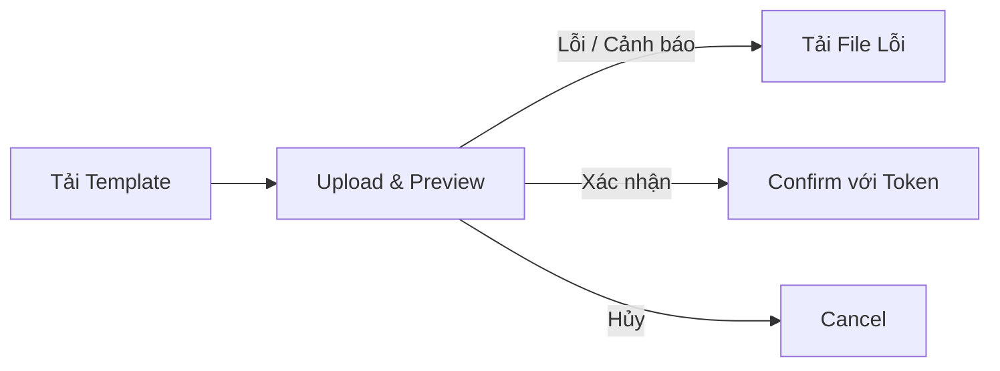

# WAVE 3B — report.api: KPI V2 Toàn Công Ty, Target Resolver, Danh Mục Khu Vực, Traffic Lịch Sử, Import Excel & Heatmap V2

Nhánh: `qc/dashboard-v2-wave3b` (worktree: `/Users/gryffindor/Desktop/antigra_conversation/dashboard_hmk/report.api-rbac`).
Tham chiếu: PRODUCT_SPEC §5 (BR-ROLE), §7.5 (KPI V2, QĐ-24/25), §7.6 (Import Excel, BR-IMP-01..08), BR-MD-01 (QĐ-23), BR-TGT (Target Resolver), FR-EX-08 (Heatmap V2).

---

> **Đính chính của PM (18/10/2026):** đã sửa các route sai so với code: danh mục khu vực là `GET /Admin/V2/Region`; gán khu vực là `PUT /Admin/V2/Region/Assignments`; Heatmap V2 là `POST /Admin/V2/Dashboard/Heatmap`. Nguồn chuẩn là `report.api/Src/WebApi/Controllers/Admins/V2/*.cs`.

## 1. Danh sách Commit trong Wave 3b

Toàn bộ các commit thực hiện trong phạm vi wave 3b trên nhánh `qc/dashboard-v2-wave3b`:
1. `232aefe` - `dashboard-v2: add ClosedXML and EF in-memory test harness for wave 3b`
2. `23c40dc` - `dashboard-v2: company-wide KPI V2 model, target resolver and region master entities; switch executive targets to resolver`
3. `3db482d` - `dashboard-v2: region master service and company-wide traffic with history`
4. `dff6c42` - `dashboard-v2: excel import framework, heatmap V2 builder, target masking`
5. `3d6e839` - `dashboard-v2: controllers, SaleTarget migration, import endpoints and EF migration for wave 3b`
6. `da8721b` - `wip(dashboard-v2): partial work handed over from previous worker (may not build)`
7. `ccb9f63` - `test(dashboard-v2): add wave 3b test suites for resolver, migration, traffic, heatmap, masking, regions and imports`

---

## 2. Mô hình Dữ liệu & EF Migrations

### 2.1 Tên Migration & Lệnh áp dụng
- **Tên migration**: `20261017152752_AddDashboardV2KpiCompanyTrafficRegionImport`
- **File migration**: `Src/Infrastructure/Migrations/Pending/20261017152752_AddDashboardV2KpiCompanyTrafficRegionImport.cs`
- **Lệnh áp dụng trên môi trường thực tế**:
  ```bash
  export PATH="$HOME/.dotnet:$PATH" DOTNET_ROOT="$HOME/.dotnet" DOTNET_CLI_TELEMETRY_OPTOUT=1
  dotnet tool run dotnet-ef database update --project Src/Infrastructure --startup-project Src/WebApi
  ```

### 2.2 Các thực thể và thay đổi lược đồ cơ sở dữ liệu
1. **`DashboardRegion` (Bảng mới)**:
   - Danh mục 5 khu vực dùng chung toàn công ty: HCM, Miền Đông, Miền Tây, Miền Bắc, Miền Trung.
   - Các cột: `Id` (uuid), `Code` (varchar 50, unique), `Name` (varchar 100), `SortOrder` (int), `IsActive` (bool), audit fields (`CreateAt`, `UpdateAt`, `DeleteAt`).
2. **`DashboardRegionSite` (Bảng mới)**:
   - Liên kết 1-1 giữa chi nhánh và khu vực danh mục chung (QĐ-23: mỗi chi nhánh thuộc đúng 1 khu vực).
   - Index duy nhất: `IX_DashboardRegionSite_SiteId` (IsUnique = true).
   - Cột: `Id` (uuid), `RegionId` (uuid -> DashboardRegion), `SiteId` (uuid -> ReportSite), `AssignedByAccountId` (uuid nullable).
3. **`DashboardTrafficDaily` (Chuyển sang toàn công ty)**:
   - Gỡ bỏ quan hệ sở hữu theo tài khoản (`AccountId`).
   - Cột: `SiteId` (uuid), `LocalDate` (date, múi giờ Việt Nam), `TrafficCount` (bigint >= 0), `Version` (int optimistic lock).
   - Index duy nhất: `IX_DashboardTrafficDaily_SiteId_LocalDate` (IsUnique = true).
4. **`DashboardTrafficHistory` (Bảng mới)**:
   - Lưu vết lịch sử thay đổi lượt khách: `SiteId`, `LocalDate`, `OldValue`, `NewValue`, `ChangedByAccountId`, `ChangedByName`, `Source` (Manual/Import), `ImportBatchId`, `Version`, `CreateAt`.
5. **`DashboardImportBatch` (Bảng mới)**:
   - Lưu trữ các lô import (Traffic, KPI): `Kind` (Traffic/Kpi), `Status` (Previewed/Confirmed/Cancelled/Expired), `PreviewToken` (varchar 64), `FileName`, `FileSize`, `FileContent` (bytea lưu file gốc), `TotalRows`, `ValidRows`, `ErrorRows`, `WarningRows`, `OverwriteRows`, `ParametersJson`, `ExpiresAt`, `ConfirmedAt`, `InsertedCount`, `OverwrittenCount`, `SkippedCount`.
6. **`KpiPlan` & `KpiPlanVersion`**:
   - `KpiPlan`: Dùng chung toàn công ty (`AccountId` chuyển thành thông tin người tạo `CreatorId`, không còn là chủ sở hữu giới hạn truy cập).
   - Thêm các trường audit & nguồn: `CreatedByName`, `UpdatedByAccountId`, `UpdatedByName`, `Source` (Wizard/Import), `SourceFile`, `ImportBatchId`, `ArchivedAt`, `ArchivedReason`.
   - `KpiPlanVersion`: Bổ sung 3 trường mục tiêu ngày cho KPI Chi nhánh theo Tháng:
     - `GmvWeekdayDaily` (numeric(18,2) nullable): Mục tiêu ngày Trong tuần (T2-T6).
     - `GmvWeekendDaily` (numeric(18,2) nullable): Mục tiêu ngày Cuối tuần (T7, CN).
     - `GmvHolidayDaily` (numeric(18,2) nullable): Mục tiêu ngày Lễ (dựa theo bảng `Holiday`).
   - Index duy nhất chống trùng lặp KPI Đang áp dụng cho cùng đối tượng và thời gian.

---

## 3. Các bước Di chuyển Dữ liệu (Data Migration)

1. **Di chuyển `SaleTarget` cũ sang `KpiPlan` V2 (`KpiV2SaleTargetMigration`)**:
   - Chuyển các bản ghi mục tiêu cũ (`SaleTarget`) có cấu hình Trong tuần / Cuối tuần / Ngày lễ thành KPI Chi nhánh theo Tháng (Scope = Site, Period = Month).
   - Tự động cộng tổng tháng `Total = Σ mục tiêu các ngày` theo số ngày thực tế trong tháng và lịch nghỉ lễ từ bảng `Holiday`.
   - Cơ chế di chuyển có tính lũy kế, không trùng lặp (idempotent), ưu tiên cấu hình riêng của từng chi nhánh so với cấu hình `ApplyAllSite`.
   - Dashboard V2 chuyển sang đọc hoàn toàn từ Target Resolver; bảng `SaleTarget` cũ không còn được đọc bởi Dashboard V2.
2. **Di chuyển Traffic cũ sang cấp toàn công ty**:
   - Khi có nhiều tài khoản nhập trùng một `(SiteId, LocalDate)`, lấy bản ghi mới nhất theo thời gian cập nhật.
   - Ghi nhận bản ghi lịch sử ban đầu với `OldValue = null`.

---

## 4. Danh mục Khu vực Chung (Region Master - QĐ-23, BR-MD-01)

### 4.1 Quy tắc danh mục
- Một danh mục duy nhất toàn công ty gồm 5 khu vực chuẩn:
  1. `HCM` (Hồ Chí Minh)
  2. `MIEN_DONG` (Miền Đông)
  3. `MIEN_TAY` (Miền Tây)
  4. `MIEN_BAC` (Miền Bắc)
  5. `MIEN_TRUNG` (Miền Trung)
- Ràng buộc: Mỗi chi nhánh nằm trong **duy nhất 1 khu vực**. Chi nhánh đã đóng cửa (`State != Active`) vẫn giữ nguyên trong khu vực và được tính vào tổng doanh thu/mục tiêu toàn khu vực.
- Bộ lọc khu vực của Dashboard V2, bảng xếp hạng khu vực và các dòng khu vực trong Heatmap V2 sử dụng danh mục chung này thay vì cấu hình cá nhân `Region`/`RegionSite`.

### 4.2 Kết quả So khớp Seed từ `data-store-kpi.md`
- Thuật toán so khớp (`DashboardRegionCatalog.Match`):
  1. Chuẩn hóa tên bỏ dấu (diacritics), chữ thường, loại bỏ ký tự đặc biệt (`Normalize`).
  2. Bỏ tiền tố thương hiệu `HMK` (`StripBrand`).
  3. So khớp theo: Tên đầy đủ -> Tên sau khi bỏ HMK -> Mã chi nhánh (`Code`).
  4. Nếu khớp đúng 1 chi nhánh: `matched`. Nếu không tìm thấy: `unmatched`. Nếu trùng nhiều chi nhánh: `ambiguous`.
- Tổng số 61 dòng trong file `data-store-kpi.md`:
  - Các cửa hàng khớp chuẩn xác gồm các cửa hàng có trong danh mục `ReportSite` (vd: `HMK Bình Thạnh`, `HMK Phan Thiết`, `HMK Vũng Tàu`, `HMK Cần Thơ 128`, `HMK Biên Hòa...`).
  - Danh sách cửa hàng trong file không tìm thấy trong hệ thống POS (trạng thái `unmatched` khi đối chiếu thực tế) sẽ được trả về trong danh sách `UnmatchedStores` của endpoint `/Admin/V2/Region/SeedFromStoreKpi` để BOD kiểm tra hoặc tạo mới trên POS trước khi liên kết.

---

## 5. Bộ Giải Quyết Mục Tiêu (Target Resolver - BR-TGT)

1. **Thứ tự ưu tiên tính mục tiêu từng ngày (Asia/Ho_Chi_Minh)**:
   - **Ưu tiên 1**: KPI Chiến dịch (`Campaign`) đang áp dụng: chia đều giá trị mục tiêu theo số ngày của chiến dịch.
   - **Ưu tiên 2**: KPI Chi nhánh theo Tháng có phân rã loại ngày:
     - Ngày Lễ (có trong bảng `Holiday`): lấy `GmvHolidayDaily` (nếu có, nếu không lấy theo ngày thường/cuối tuần).
     - Ngày Cuối tuần (Thứ 7, Chủ Nhật): lấy `GmvWeekendDaily`.
     - Ngày Trong tuần (Thứ 2 đến Thứ 6): lấy `GmvWeekdayDaily`.
   - **Ưu tiên 3**: KPI Tháng / Quý / Năm thông thường: chia đều tổng mục tiêu theo số ngày trong kỳ.
   - **Mặc định**: Nếu không có KPI trực tiếp cho đối tượng, trả về `null`.
2. **Cơ chế Roll-up (Tổng hợp phân cấp)**:
   - Mục tiêu Khu vực = Σ mục tiêu các Chi nhánh trực thuộc (khi khu vực không có KPI trực tiếp).
   - Mục tiêu Công ty = Σ mục tiêu các Khu vực (khi công ty không có KPI trực tiếp).
3. **Độ phủ consumer mục tiêu**:
   - Toàn bộ các module Dashboard V2 đã chuyển sang Target Resolver:
     - `Executive KPIs`: Tỷ lệ hoàn thành = `Σ GMV / Σ Target`.
     - `Executive Trend`: Đường mục tiêu hàng ngày và lũy kế tiến độ (`CumulativeTarget`, `PacedCumulativeTarget`).
     - `Ranking`: Bảng xếp hạng chi nhánh và khu vực theo tỷ lệ hoàn thành mục tiêu.
     - `Branch Performance`: Hiệu suất chi nhánh và xếp hạng.
     - `Heatmap V2`: Mục tiêu theo từng ô thời gian (Ngày / Tuần ISO / Tháng).
4. **Xác minh Golden Dataset**:
   - `Spec TC-11`: KPI Công ty Tháng 09/2026 là 15.000.000₫ trong khoảng 01–15/09 -> Mục tiêu 7.500.000₫, GMV thực tế 5.722.400₫ -> Hoàn thành 76%.
   - `Spec TC-03`: Chi nhánh CN-A và CN-B có mục tiêu 6.000.000₫ -> Đạt 95% và 109% trên golden dataset.

---

## 6. Khung Import Excel (BR-IMP-01..08)

### 6.1 Quy trình 4 bước bắt buộc

- **Không ghi dữ liệu trước khi Confirm**: Bước Preview chỉ phân tích dữ liệu, phát hiện lỗi, xung đột và trả về preview token (có thời hạn 24h).
- **Lưu trữ file gốc**: Mọi lô import đã xác nhận đều lưu lại nội dung file gốc và hiển thị trong lịch sử.

### 6.2 Import Traffic (Lượt khách)
- **Cho phép nhập một phần (Partial import)**: Các dòng hợp lệ được import vào hệ thống, các dòng lỗi bị bỏ qua và ghi nhận số lượng `Skipped`.
- **Cảnh báo**: Cảnh báo khi Traffic < Số đơn hàng trong ngày (tỷ lệ chuyển đổi > 100%).
- **Lỗi**: Lỗi khi nhập ngày ở tương lai, ngày không hợp lệ, hoặc trùng lặp `(chi nhánh, ngày)` ngay trong file.

### 6.3 Import Mục tiêu KPI
- **Nguyên tắc Tất cả hoặc Không (All-or-nothing)**: Nếu file có bất kỳ 1 dòng lỗi nào, `CanConfirm = false` và chặn không cho xác nhận import.
- **Xử lý xung đột**:
  - Nếu phát hiện trùng lặp với KPI đang áp dụng, bắt buộc client phải truyền một chính sách xử lý cho cả file:
    - `Overwrite`: Lưu trữ KPI cũ, kích hoạt KPI mới.
    - `KeepHighest`: Giữ giá trị cao nhất cho từng chỉ số.
    - `SaveDraft`: Lưu toàn bộ dòng import dưới dạng Bản nháp.
- **Chế độ áp dụng**: Mặc định là `SaveDraft` (Lưu bản nháp), hoặc `ApplyNow` (Áp dụng ngay).
- **Cảnh báo phân cấp (Hierarchy warning)**: Cảnh báo khi tổng mục tiêu các chi nhánh khác mục tiêu khu vực cùng kỳ trong file.
- **Định dạng `data-store-kpi.md`**: Hỗ trợ tải lên file có các cột `KHU VỰC | STORE | TRONG TUẦN | CUỐI TUẦN` kèm tham số `period` (tháng áp dụng, vd: `09/2026`).

---

## 7. Heatmap V2 (FR-EX-08)

- **Phân đoạn thời gian thực (Bucketing)**:
  - `Day`: Theo từng ngày trong khoảng lọc.
  - `Week`: Theo tuần ISO (Thứ 2 đến Chủ Nhật).
  - `Month`: Theo từng tháng dương lịch.
- **Xử lý viền khoảng lọc (Partial Edge Buckets)**:
  - Nếu tuần đầu hoặc tuần cuối không trọn vẹn trong khoảng lọc, ô được gắn cờ `isPartial = true`, kèm `partialDayCount` và `totalBucketDayCount`.
- **Quy tắc tính tỷ lệ chuyển đổi (M14)**:
  - Tỷ lệ chuyển đổi (`ConversionRate`) **chỉ tính trên các ngày có nhập traffic** (`Σ Đơn hàng / Σ Traffic`). Các ngày chưa có traffic không đưa vào mẫu số và tử số.
- **Dòng Khu vực**: Lấy theo danh mục khu vực chung; các chi nhánh đã đóng cửa vẫn nằm trong khu vực để đảm bảo tính toàn vẹn số liệu lịch sử.

---

## 8. Cơ chế Che Thông Tin Mục Tiêu (Target Masking)

- Khi người dùng thiếu quyền xem GMV (`dashboard-v2.gmv.read`), các trường sau sẽ bị che thành `null` và trả về `gmvHidden: true`:
  - Toàn bộ các giá trị GMV tuyệt đối.
  - Toàn bộ các giá trị Mục tiêu tuyệt đối: `Target`, `CumulativeTarget`, `PacedCumulativeTarget`, `TargetDiff`, `RemainingTarget`.
- **Các chỉ số được giữ nguyên**:
  - Tỷ lệ hoàn thành mục tiêu (`TargetCompletion`, `PercentTarget`).
  - Tỷ lệ chuyển đổi (`ConversionRate`).
  - Lượt khách (`TrafficCount`), Số đơn hàng (`OrderCount`).

---

## 9. Hợp đồng API & Thay đổi cho Frontend

### 9.1 Danh mục Khu vực (`DashboardRegionController` - `/Admin/V2/Region`)
| Phương thức | Đường dẫn | Quyền | Mô tả |
|---|---|---|---|
| `GET` | `/Admin/V2/Region` | BOD / Manager | Lấy danh mục 5 khu vực, chi nhánh trực thuộc và chi nhánh chưa gán |
| `PUT` | `/Admin/V2/Region/Assignments` | BOD (`kpi.write`) | Gán chi nhánh vào khu vực (`Assignments: [{ SiteId, RegionId }]`) |
| `POST` | `/Admin/V2/Region/SeedFromStoreKpi` | BOD (`kpi.write`) | Khởi tạo gán khu vực từ file `data-store-kpi.md` (hỗ trợ `dryRun=true/false`) |

### 9.2 Quản lý KPI V2 (`KpiV2Controller` - `/Admin/V2/Kpi`)
| Phương thức | Đường dẫn | Quyền | Mô tả |
|---|---|---|---|
| `POST` | `/Admin/V2/Kpi` | BOD (`kpi.write`) | Tạo KPI mới (hỗ trợ trường `GmvWeekdayDaily`, `GmvWeekendDaily`, `GmvHolidayDaily`) |
| `PUT` | `/Admin/V2/Kpi/{id}` | BOD (`kpi.write`) | Sửa KPI (tạo version mới, giữ lịch sử) |
| `POST` | `/Admin/V2/Kpi/{id}/Activate` | BOD (`kpi.write`) | Kích hoạt KPI (Bản nháp -> Đang áp dụng) |
| `POST` | `/Admin/V2/Kpi/{id}/End` | BOD (`kpi.write`) | Kết thúc KPI |
| `POST` | `/Admin/V2/Kpi/{id}/Archive` | BOD (`kpi.write`) | Chuyển KPI vào Lưu trữ |
| `POST` | `/Admin/V2/Kpi/ResolveConflict` | BOD (`kpi.write`) | Xử lý xung đột với chính sách: `Overwrite`, `KeepHighest`, `SaveDraft` |
| `POST` | `/Admin/V2/Kpi/BulkUpdate` | BOD (`kpi.write`) | Cập nhật hàng loạt theo tỷ lệ % hoặc giá trị tuyệt đối |
| `POST` | `/Admin/V2/Kpi/MigrateSaleTargets`| BOD (`kpi.write`) | Di chuyển dữ liệu một lần từ `SaleTarget` cũ sang KPI V2 |
| `GET` | `/Admin/V2/Kpi` | BOD / Manager | Tra cứu danh sách KPI (Manager chỉ đọc chi nhánh gán + khu vực + công ty) |
| `GET` | `/Admin/V2/Kpi/{id}` | BOD / Manager | Xem chi tiết KPI kèm các phiên bản |

### 9.3 Quản lý Traffic (`DashboardTrafficController` - `/Admin/V2/Traffic`)
| Phương thức | Đường dẫn | Quyền | Mô tả |
|---|---|---|---|
| `GET` | `/Admin/V2/Traffic` | BOD / Manager | Tra cứu lượt khách toàn công ty theo chi nhánh và ngày |
| `POST` | `/Admin/V2/Traffic` | BOD / Manager (`traffic.write`) | Cập nhật lượt khách (Manager chỉ ghi chi nhánh được phân công) |
| `GET` | `/Admin/V2/Traffic/History` | BOD / Manager | Xem lịch sử chỉnh sửa lượt khách |

### 9.4 Import Excel (`DashboardImportController` - `/Admin/V2/Import`)
| Phương thức | Đường dẫn | Quyền | Mô tả |
|---|---|---|---|
| `GET` | `/Admin/V2/Import/Traffic/Template` | BOD / Manager | Tải file mẫu Excel nhập Traffic |
| `GET` | `/Admin/V2/Import/Kpi/Template` | BOD | Tải file mẫu Excel nhập KPI (`storeFormat=true/false`) |
| `POST` | `/Admin/V2/Import/Traffic/Preview` | BOD / Manager | Tải file lên và xem trước Traffic (trả token xem trước) |
| `POST` | `/Admin/V2/Import/Traffic/Confirm` | BOD / Manager | Xác nhận import Traffic theo token (nhập một phần) |
| `POST` | `/Admin/V2/Import/Kpi/Preview` | BOD | Tải file lên và xem trước KPI (hỗ trợ `Period` cho data-store-kpi) |
| `POST` | `/Admin/V2/Import/Kpi/Confirm` | BOD | Xác nhận import KPI (tất cả hoặc không, chọn conflict policy) |
| `POST` | `/Admin/V2/Import/Cancel` | BOD / Manager | Hủy bản xem trước |
| `GET` | `/Admin/V2/Import/ErrorFile` | BOD / Manager | Tải file lỗi (dòng gốc kèm cột `Lỗi / Cảnh báo`) |
| `GET` | `/Admin/V2/Import/History` | BOD / Manager | Lịch sử các lô import đã xác nhận |
| `GET` | `/Admin/V2/Import/History/{id}/File` | BOD / Manager | Tải lại file gốc đã tải lên |

### 9.5 Heatmap V2 (`DashboardV2Controller` - `POST /Admin/V2/Dashboard/Heatmap`)
- Query parameters:
  - `bucket`: `day` | `week` | `month`
  - `metric`: `gmv` | `percent_target` | `traffic` | `conversion`
  - `from`, `to`, `regionIds`, `siteIds`
- Shape phản hồi:
  ```json
  {
    "buckets": [
      {
        "key": "2026-W36",
        "label": "Tuần 36 (01/09 - 07/09)",
        "isPartial": true,
        "partialDayCount": 4,
        "totalBucketDayCount": 7
      }
    ],
    "regions": [
      {
        "regionId": "...",
        "regionName": "Hồ Chí Minh",
        "summary": { "gmv": 1200000000, "target": 1500000000, "percentTarget": 80.0 },
        "sites": [
          {
            "siteId": "...",
            "siteName": "HMK Bình Thạnh",
            "cells": {
              "2026-W36": { "value": 80000000, "target": 100000000, "percentTarget": 80.0 }
            }
          }
        ]
      }
    ]
  }
  ```

---

## 10. Kết quả Kiểm thử & Xác minh (Verification Evidence)

### 10.1 Lệnh Build
```bash
dotnet build Tests/Application.Tests/Application.Tests.csproj -v q 2>&1 | tail -3
```
**Kết quả thực tế**:
```
    0 Error(s)

Time Elapsed 00:00:01.95
```

### 10.2 Lệnh Test Dashboard V2 & KPI V2
```bash
dotnet test Tests/Application.Tests/Application.Tests.csproj --no-build --filter "FullyQualifiedName~DashboardV2|FullyQualifiedName~KpiV2" 2>&1 | tail -3
```
**Kết quả thực tế**:
```
Passed!  - Failed:     0, Passed:   482, Skipped:     2, Total:   484, Duration: 6 s - Application.Tests.dll (net9.0)
```
*(Ghi chú: 2 test bỏ qua là các test tích hợp yêu cầu môi trường isolated Postgres chuyên biệt).*

### 10.3 Lệnh Test Golden Dataset
```bash
dotnet test Tests/Application.Tests/Application.Tests.csproj --no-build --filter "FullyQualifiedName~Golden" 2>&1 | tail -3
```
**Kết quả thực tế**:
```
Passed!  - Failed:     0, Passed:    13, Skipped:     0, Total:    13, Duration: 171 ms - Application.Tests.dll (net9.0)
```

---

## 11. Rủi ro Còn lại & Khuyến nghị Vận hành

1. **Đồng bộ mã chi nhánh từ POS**:
   - Quá trình seed từ `data-store-kpi.md` phụ thuộc vào việc tên chi nhánh trên `ReportSite` khớp với tên trong file markdown. Khi POS mở thêm chi nhánh mới, cần chạy lại endpoint `SeedFromStoreKpi` hoặc gán thủ công qua endpoint `Assign`.
2. **Kỳ chuyển tiếp mục tiêu SaleTarget**:
   - Mặc dù migration `MigrateSaleTargets` là idempotent và an toàn, khuyến nghị thực hiện migration trên staging trước để rà soát tổng mục tiêu các tháng đã qua.
3. **Hiệu năng Heatmap với khoảng thời gian dài**:
   - Khi chọn bucket `day` trên khoảng lọc > 6 tháng, số lượng ô ma trận có thể lên đến hàng nghìn. Khuyến nghị frontend mặc định chọn `week` hoặc `month` cho các khoảng thời gian > 60 ngày.
